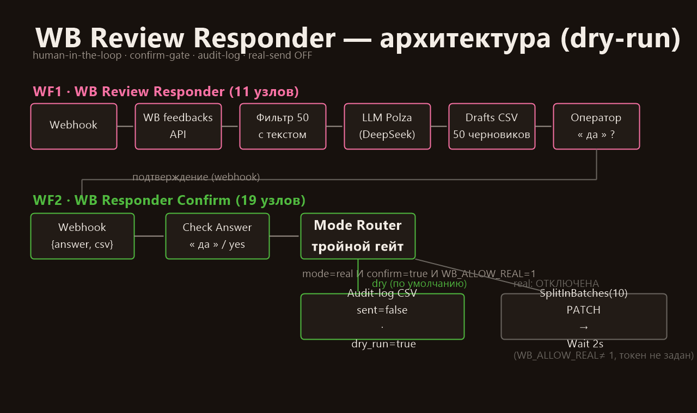

# WB Review Responder

Агент для Wildberries: анализирует отзывы, готовит черновики ответов, человек подтверждает «ОК», система пишет audit-log. Real-send отключён — только dry-run.

> ⚠️ **Дисклеймер:** Real-send отключён, только dry-run. Ответы покупателям не публикуются: боевой ветки отправки нет в графе, а гейт включения (env `WB_ALLOW_REAL`) не активирован. Все прогоны заканчиваются audit-log'ом с `sent=false, dry_run=true`.

## Что умеет

- **Разбор отзывов** — забор отзывов о товаре из WB feedbacks API (публичный, без ключа), фильтр непустых текстов
- **Генерация ответов через LLM** — вежливый представитель бренда: черновик на каждый отзыв (~80 мс/ответ)
- **Human-in-the-loop: агент предлагает, человек решает** — LLM ничего не публикует; оператор видит CSV черновиков и даёт явное «да»
- **Audit-log (dry-run, без автопубликации)** — подтверждённый прогон фиксируется в логе `reviewId, draft, sent=false, dry_run=true, timestamp`

## Метрики

- **100 отзывов за 8.1 с** (классификация: категория + тональность; вручную ≈ 2 часа)
- **50/50 черновиков ответов непустые за 3.8 с**, после явного «да» — 50/50 строк в audit-log (dry-run)
- **5 итераций автономного ремонта** — каждая с реальной первопричиной (мёртвые креды, порча экранирования JS, rate-limit WB и др.)

## Стек

- **n8n** (self-hosted) — оркестрация, два workflow
- **Polza (DeepSeek)** — LLM-канал: классификация и генерация черновиков
- **Node.js** — Code-ноды, MCP-сервер Code Mode (search/execute sandbox, confirm-gate)

## Безопасность

- **Confirm-gate** — write-методы без явного подтверждения не исполняются (agent-side: `confirmation_required`; workflow-side: двойной ключ `mode=real` + `confirm=true`)
- **Dry-run по умолчанию** — состояние по умолчанию для любого запроса
- **Real-send отключён** — тройной гейт: `mode=real` **И** `confirm=true` **И** env `WB_ALLOW_REAL=1`; боевой ветки в исполняемом состоянии нет
- Секрет-индирекция: токены только через `={{$env.NAME}}`, сырых ключей в workflow/репо нет

## Архитектура



Два workflow:

1. **WB Review Responder (WF1, 11 узлов):** Webhook → WB feedbacks API → фильтр 50 отзывов с текстом → промпты → Polza LLM → связка черновик↔отзыв → CSV черновиков → запрос подтверждения оператору
2. **WB Responder Confirm (WF2, 19 узлов):** Webhook `{answer, csv}` → проверка «да» (Code-чекер) → **Mode Router** (тройной гейт) → dry-ветка: audit-log CSV / real-ветка: выключена (SplitInBatches(10)+PATCH+Wait 2s — реализована, но заблокирована гейтом и отсутствием env-ключей)

## Структура репозитория

```
├── README.md
├── LICENSE (MIT)
├── workflow/
│   ├── wb-review-responder.json      ← WF1: отзывы → LLM → черновики CSV
│   └── wb-responder-confirm.json     ← WF2: confirm + тройной гейт + audit-log
├── metrics/
│   ├── metrics.json                  ← кейс классификации (100 отзывов / 8.1 с)
│   └── metrics-responder.json        ← кейс responder (50/50, dry-run confirm)
└── docs/
    └── architecture.png              ← диаграмма пайплайна
```

Сырые данные отзывов и черновиков в репозиторий не выкладываются (данные клиентов). Импорт: n8n → Import from File → любой `workflow/*.json`.

## Лицензия

MIT — см. [LICENSE](LICENSE).
